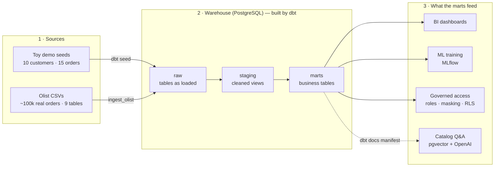

# E-commerce Data Platform — Airflow + dbt + PostgreSQL

An end-to-end analytics platform for e-commerce data,
built on **Apache Airflow 2.9**, **dbt-core 1.8** and **PostgreSQL 15**. It runs entirely in Docker
on a laptop and can be deployed to AWS with Terraform.

It takes raw order data, turns it into tested, governed, business-ready tables, and then uses those
tables for BI, machine learning and natural-language search over the data catalog.

---

## The whole picture



**Apache Airflow orchestrates every arrow above.** Four DAGs do the work:

| DAG | Schedule | Job |
|---|---|---|
| `dbt_pipeline` | daily | Ingest the Olist CSVs, then build and test every dbt model (one Airflow task per model/test) |
| `mlflow_training` | weekly | Train a customer lifetime-value model on the toy mart |
| `mlflow_training_olist` | weekly | Train the same model on real Olist customers |
| `rag_index` | manual | Embed the dbt catalog descriptions so you can ask questions about the data |

Two datasets flow through the same wiring on purpose:

- **Toy demo** — 10 customers and 15 orders. Tiny, always works, shows the plumbing.
- **Olist** — the public [Brazilian E-Commerce dataset](https://www.kaggle.com/datasets/olistbr/brazilian-ecommerce)
  (~100k real, anonymized orders). Proves the same design at realistic scale.

---

## What's in the platform

| Capability | What it means here | Where it lives |
|---|---|---|
| **Orchestration** | Airflow DAGs with shared retries and Slack failure alerts | `dags/` |
| **Ingestion** | Idempotent load of 9 Olist CSVs into the `raw` schema | `dags/dbt_pipeline_dag.py` |
| **Transformation** | dbt staging views → mart tables, for both datasets | `dbt_project/models/` |
| **Data quality** | dbt schema tests + singular tests on business invariants | `dbt_project/models/**/schema.yml`, `dbt_project/tests/` |
| **Governance** | `engineer` / `analyst` roles, PII masking, row-level security | `governance/`, `dbt_project/macros/` |
| **MLOps** | Lifetime-value model training tracked in MLflow | `dags/mlflow_training*_dag.py` |
| **Catalog search (RAG)** | Ask questions about the data catalog in plain English | `dags/rag_index_dag.py`, `rag/` |
| **Data catalog** | Optional OpenMetadata stack | `openmetadata/` |
| **Testing & CI** | pytest + ruff on every push and pull request | `tests/`, `.github/workflows/ci.yml` |
| **Environments** | Dev and "prod" stacks side by side from one compose file | `docker-compose.yml`, `.env*.example` |
| **Cloud deployment** | AWS (ECS Fargate, RDS, ECR, S3) via Terraform, manual deploy workflow | `terraform/`, `.github/workflows/deploy.yml` |

---

## Repository map

```
.
├── README.md                  ← you are here: the big picture
├── docs/                      ← all detailed documentation (start at docs/README.md)
│   ├── architecture.md        #   how the pieces fit together
│   ├── local-development.md   #   run, test, dev + prod stacks
│   ├── aws-deployment.md      #   deploy to AWS and tear down
│   └── superpowers/           #   per-phase design specs + implementation plans
│
│  ── Pipeline code ──────────────────────────────────────────────────────────
├── dags/                      # Airflow DAGs
│   ├── dbt_pipeline_dag.py        # main DAG: ingest_olist + dbt seed/run/test (Cosmos)
│   ├── mlflow_training_dag.py     # toy-demo ML training
│   ├── mlflow_training_olist_dag.py  # Olist ML training
│   ├── rag_index_dag.py           # embeds dbt catalog descriptions into pgvector
│   ├── _db.py                     # shared warehouse connection helper
│   └── _operational_defaults.py   # shared retries + Slack alerting
├── dbt_project/               # dbt project (the transformations)
│   ├── seeds/                     # toy demo raw CSVs
│   ├── models/
│   │   ├── staging/  marts/           # toy demo
│   │   └── olist_staging/  olist_marts/   # Olist: 9 staging views, 2 marts
│   ├── macros/                    # grant + row-level-security post-hooks
│   └── tests/                     # singular tests (business invariants)
├── rag/query.py               # CLI: ask a question about the catalog
├── governance/setup_roles.sql # roles, grants, row-level security
├── data/olist/                # put the downloaded Olist CSVs here (gitignored)
│
│  ── Infrastructure ─────────────────────────────────────────────────────────
├── docker-compose.yml         # every local service (dev and prod stacks)
├── Dockerfile                 # the one Airflow image (dbt, Cosmos, MLflow…) used locally and on AWS
├── requirements.txt           # Python deps baked into the image
├── .env.example / .env.prod.example   # templates for the gitignored .env / .env.prod
├── warehouse-init/            # SQL run when the warehouse is first created (pgvector)
├── openmetadata/              # templates for the optional data-catalog ingestion
├── terraform/                 # AWS infrastructure
│
│  ── Quality ────────────────────────────────────────────────────────────────
├── tests/                     # pytest suite (+ small Olist sample fixtures)
├── requirements-dev.txt       # pytest, ruff
├── pyproject.toml             # pytest / ruff config
└── .github/workflows/         # ci.yml (tests on every push) · deploy.yml (manual AWS deploy)
```

`logs/` and `plugins/` appear at the repo root once the stack runs; both are gitignored.

---

## Quick start

Needs [Docker Desktop](https://www.docker.com/products/docker-desktop/) with ~4 GB RAM.

```bash
cp .env.example .env            # then fill in the values (the file explains each one)
docker compose up -d --build    # first build takes a few minutes
docker compose logs -f airflow-init   # wait for it to finish
```

Then open the Airflow UI at http://localhost:8080 (user `admin`, password from `.env`).

Before the first `dbt_pipeline` run you need two one-time steps — creating the warehouse roles and
downloading the Olist CSVs. Both are covered, with every other command, in
**[docs/local-development.md](docs/local-development.md)**.

---

## Documentation

| I want to… | Read |
|---|---|
| Understand the architecture and data flow in detail | [docs/architecture.md](docs/architecture.md) |
| Run it locally, run the tests, or run dev + prod side by side | [docs/local-development.md](docs/local-development.md) |
| Deploy to AWS | [docs/aws-deployment.md](docs/aws-deployment.md) |
| See why things were built the way they were, phase by phase | [docs/README.md](docs/README.md#project-history-specs--plans) |

---

## How it was built

| Phase | Added |
|---|---|
| Foundation | Airflow + dbt + Postgres toy pipeline, governance, MLflow, RAG, OpenMetadata |
| Olist integration | Real e-commerce data through the same pipeline |
| 1 — Testing & CI | pytest suite, linting, GitHub Actions |
| 2 — Reliability | Retries, Slack alerting, idempotent tasks |
| 3 — Dev/prod separation | A second, isolated "prod" stack |
| 4 — Cloud deployment | AWS infrastructure and deploy workflow |
